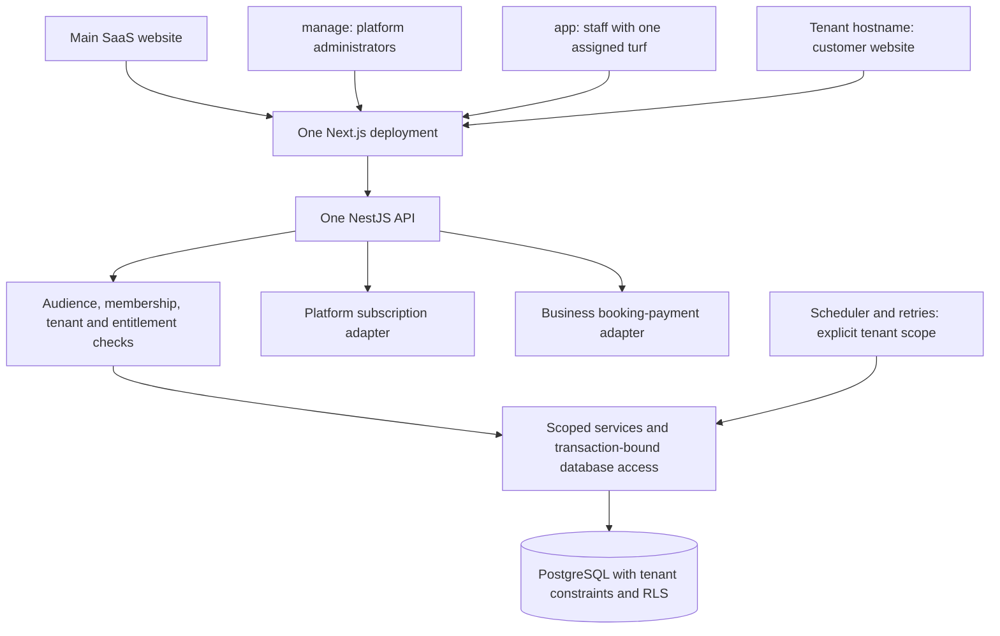

# Multi-tenant SaaS feature and delivery plan

Date: 17 November 2026, Asia/Dhaka.
Status: implementation started on feat/tenant-foundation. The first tenant models, account APIs and isolated proof are implemented. The separate workspace frontend has been removed; owners use the existing dashboard and Settings. Broad business migration and launch gates remain pending. See the [progress report](tenant-foundation-progress.md).

Platform administration has a first read-only implementation with separate sign-in, explicit PlatformGrant access, real tenant overview/directory/detail APIs and responsive console pages. See [platform dashboard progress](platform-admin-progress.md). Business onboarding and subscription billing remain pending.
Evidence and tradeoffs: [Research report](multi-tenant-saas-research.md).
Baseline: frontend `72b69fd`, API `59f6e85`.

## 1. Outcome and scope

Convert the current booking product into a SaaS for independent turf businesses, billed monthly or yearly, while preserving the current business's data and booking behavior.

V1 product rule: each turf owner manages one turf business. Owners sign in directly to their dashboard and use Settings for turf information. There is no separate workspace, My turf page, business chooser or switcher. The SaaS platform manages many independent owners/businesses. A turf business may still contain multiple grounds or sports. Multi-business ownership is outside this version.

The first engineering milestone is two isolated test businesses in staging. The paid MVP adds business onboarding, a platform administration area, subscription billing, and operational readiness.

| Confirmed direction                             | Delivery interpretation                                                               |
| ----------------------------------------------- | ------------------------------------------------------------------------------------- |
| One tenant is one independent turf business     | A tenant can have several grounds; branches are not a new entity in this release      |
| Existing frontend and API projects              | Separate application areas and API permissions, with shared code and deployments      |
| Monthly/yearly SaaS subscription                | Software fees belong to the platform; customer booking money belongs to each business |
| Main domain, manage, app, and tenant subdomains | Four audiences share one frontend deployment                                          |

Out of scope for this conversion: cross-business marketplace search, native apps, franchise/branch hierarchy, commissions, arbitrary tenant JavaScript/HTML, support impersonation, per-slot cancellation, partial booking refunds, and a framework/ORM major-version upgrade. Existing deferred features remain deferred.

## 2. Audiences, hosts, and access

| Host, using a placeholder brand | Pages                                                               | Authority                                                                                          |
| ------------------------------- | ------------------------------------------------------------------- | -------------------------------------------------------------------------------------------------- |
| yourbrand.com                   | Marketing, pricing, signup, help                                    | Public platform content                                                                            |
| manage.yourbrand.com            | Platform login, tenants, plans, subscription operations, audit      | Explicit platform administrator grant                                                              |
| app.yourbrand.com               | Staff login, invitations, assigned turf dashboard, business billing | User membership in their assigned tenant                                                           |
| greenfield.yourbrand.com        | Tenant homepage, grounds, checkout, customer sign-in/account        | Public tenant context; customer authentication or a scoped signed link for private booking actions |
| api.yourbrand.com               | NestJS API                                                          | API authorization; host name alone grants no access                                                |

All frontend hosts use the current Next.js project. Most browser API calls continue through a same-origin frontend proxy.

Resolve the owner's assigned turf on the API and open its dashboard directly. Keep the verified tenant identity in business requests and query keys. Owners do not choose a business or use a last-used-business preference in V1. An explicit tenant URL, where needed internally, must still match the assigned turf.

Reserve at least www, app, manage, admin, api, auth, billing, support, and docs. Normalize and uniquely register hostnames. Unknown hosts return a neutral not-found response. Internal rewrites must not expose platform pages on customer hosts.

Customer custom domains are P2. Ownership and certificate readiness are prerequisites to activation. Keep staff administration on app and choose one primary public origin per tenant.

## 3. Proposed architecture

Business rules, permissions, subscription entitlements, and slot reservation stay in the API. The frontend displays their results and supplies user-friendly validation.

### Data ownership

| Ownership                            | Models and changes                                                                                                                     |
| ------------------------------------ | -------------------------------------------------------------------------------------------------------------------------------------- |
| Platform identities/catalog          | Existing User identity, explicit PlatformGrant, Tenant, TenantMembership, TenantInvitation, TenantDomain, Plan, PlanVersion, PlanPrice |
| Platform billing, linked to a tenant | Subscription, BillingInvoice, BillingEvent, bounded AccessGrant, PlatformAuditEvent; separate from booking Payment                     |
| Tenant booking operations            | Ground, Slot, SlotEvent, Closure, Customer, Booking, BookingSlot, BookingSeries, BookingSeriesSkip, Payment, BookingEvent              |
| Tenant configuration/operations      | SlotSettings, SettingsSection, SettingsEvent, tenant-specific SystemState, EmailLog, asset ownership, TenantMerchantAccount            |
| Genuine infrastructure state         | Explicit platform/infrastructure scope; do not fabricate a tenant for deployment health or global scheduler coordination               |

Tenant stores stable id, unique slug, name, lifecycle status, timezone, and currency. Initially preserve the current Asia/Dhaka and BDT defaults. Changing currency must never reinterpret existing stored amounts; keep existing dates in their established venue-local representation.

Membership roles: owner, admin, manager. Define the action matrix against existing permissions before coding; at minimum owner controls business billing/ownership, admin controls permitted business settings/staff, and manager retains operational booking access. Protect the last owner from accidental removal.

PlatformGrant is separate from membership. Choose the existing business's initial owner explicitly during migration; do not promote every existing admin to platform administrator.

Customer profiles remain per tenant. The same normalized phone can exist in two businesses with independent notes, session versions, and booking history.

SlotSettings becomes one row per tenant with a unique tenantId. SettingsSection and tenant SystemState use tenant-plus-key uniqueness; genuine infrastructure state has a separate explicit scope.

TenantMerchantAccount records provider/account identity, capabilities and versioned receiving details. Keep secret material server-only in encrypted secret storage, and preserve the merchant-account association on each payment so later refunds use the original account.

Proposed MVP policy: freeze a tenant's currency/timezone after its first booking; corrections require a reviewed migration. Snapshot applicable currency/account details on financial records.

### Database and session rules

- Tenant-owned records require tenantId after the enforcement release.
- Use composite relationships where needed so a tenant A booking cannot reference tenant B's ground, slot, customer, series, payment, or actor membership.
- Scope business uniqueness intentionally, including customer phone, membership, settings keys, and system checkpoints. Keep globally unique UUID identities and the slot live-ownership guards.
- Review human booking-number uniqueness; preserve existing numbers and choose tenant counters/prefixes without changing historical receipts.
- Review wallet reference uniqueness against tenant and receiving-account semantics. Preserve the existing partial-index behavior for failed/deleted payments.
- A reviewed replacement for Payment_method_reference_key must precede removal of its old global constraint. Coordinate error mapping, schema comments, tests, and the repository's existing index-preservation instructions.
- Prove RLS under a non-owner, non-superuser runtime role without BYPASSRLS. Migration credentials belong to a separate controlled release job.
- Tenant database context is transaction-local and uses the same transaction client for every dependent query. Context must not survive connection reuse. Missing context denies tenant data access.
- Keep transaction boundaries around database work; external payment/email calls must not hold a request-long database transaction open.
- Maintain separate platform, staff, and customer token audiences. Staff identity plus the explicitly selected tenant requires current membership checks. Customer tokens and new signed booking links are bound to their tenant.
- Use host-only Secure/HttpOnly production cookies, appropriate SameSite behavior, and Origin/CSRF protection for mutations. A customer custom domain does not share staff or platform login cookies.

### Proposed API boundaries

These paths define the intended boundaries. Platform authentication, overview and tenant directory/detail reads are implemented with separate platform sessions and explicit grants. Staff authentication and `GET /api/v1/admin/me/tenant` for the user's one assigned turf are implemented; integrating that resolver into the existing dashboard remains pending. The earlier list and explicit profile reads remain available to the foundation proof. Other new operations remain proposals. Finalize their DTOs and compatibility adapters before changing business clients.

| Namespace                                            | Purpose                                                                        |
| ---------------------------------------------------- | ------------------------------------------------------------------------------ |
| `/api/v1/platform/auth/*` and `/api/v1/platform/*`   | Platform sessions, tenant/catalog administration, platform billing operations  |
| `/api/v1/admin/auth/*` and `/api/v1/admin/me/tenant` | Staff identity, invitations, assigned turf account                             |
| `/api/v1/tenants/:tenantId/admin/*`                  | Existing business operations, now with explicit tenant scope                   |
| `/api/v1/public/tenants/:slug/*`                     | Published grounds, branding, availability and public checkout configuration    |
| `/api/v1/tenants/:tenantId/customer/*`               | Customer authentication and protected customer operations                      |
| Separate billing and booking webhook routes          | Verified provider events, account/resource-to-tenant resolution, deduplication |

Tenant identifiers are selectors. The API independently authorizes staff membership, customer tenant binding, or public publication status. Strip untrusted internal headers in the frontend proxy; direct API requests receive the same checks. The existing API envelope, pagination, and error conventions remain.

## 4. Feature backlog and release order

Priority: P0 blocks a second external tenant; P1 is required for paid launch; P2 follows the paid MVP. Dependencies are milestones, not estimated calendar dates.

| Milestone                            | Priority | Scope and feature IDs                                                                                                                     | Repository                       |
| ------------------------------------ | -------- | ----------------------------------------------------------------------------------------------------------------------------------------- | -------------------------------- |
| M0: design and isolation proof       | P0       | S01 contract/ownership inventory; S02 transaction/RLS proof; S03 decisions, flags and test baseline                                       | Both                             |
| M1: additive tenant data             | P0       | S04 tenant/domain/membership models; S05 backfill and reconciliation tooling; S06 separate platform grants                                | API                              |
| M2: tenant-aware API                 | P0       | S07 scoped business services; S08 staff/customer sessions; S09 constraints and payment-account boundaries                                 | API, frontend API clients        |
| M3: application areas                | P0       | S10 host routing/layouts; S11 assigned-turf resolution and cache isolation; S12 tenant branding, metadata, public portal and legacy links | Frontend, API DTOs               |
| M4: operations and enforcement       | P0       | S13 tenant jobs/mail/storage; S14 controlled migrations and database enforcement; S15 operational isolation and restore/export readiness  | API and hosting, frontend assets |
| M5: invited pilot and administration | P1       | S16 platform console; S17 owner/staff onboarding; S18 audit, platform MFA/recovery, lifecycle/export controls                             | Both                             |
| M6: subscriptions and paid launch    | P1       | S19 plan catalog and invoices; S20 provider adapter/events; S21 entitlement enforcement; S22 billing UI, metrics and launch verification  | Both                             |
| M7: extensions                       | P2       | S23 custom customer domains; S24 self-service upgrades and optional additions                                                             | Both                             |

Dependency chain: M0 → M1 → M2 → M3 → M4 → M5 → M6 → M7.
Parts of UI design and provider research can proceed alongside backend work; external tenant creation cannot bypass the release gates.

Proposed server-side rollout controls default to off: TENANT_ONBOARDING_ENABLED until G1, PAID_SIGNUP_ENABLED until G3, and CUSTOM_DOMAINS_ENABLED until M7. Authentication and tenant isolation are mandatory boundaries, not optional customer feature flags. Existing bookings continue through the reviewed compatibility path during rollout.

### M0: design and isolation proof

- [ ] S01: inventory every model, public/private route, query, cache, job, file path and integration; assign platform or tenant ownership.
- [ ] S02: prove RLS context against Prisma 7.10.1, the actual PostgreSQL version, and the intended connection pool. Cover interactive transactions, batch operations, nested writes, rollback, and connection reuse.
- [ ] S03: settle the narrow runtime-SQL convention for policy context, API transport, role matrix, platform authentication/MFA, and legacy-host mapping. Define measurable staging load and recovery targets.
- [ ] Capture baseline booking/payment/refund test results and current business totals without putting personal records or credentials in fixtures or documentation.

Exit: transaction proof and schema/API contract reviewed; all access paths accounted for; no framework upgrade required. If the RLS proof fails, revise the data-access design before proceeding.

### M1: additive tenant data and compatibility tooling

- [ ] S04: add Tenant, TenantDomain, TenantMembership, invitations, and additive ownership columns/indexes.
- [ ] S05: create repeatable, checkpointed backfill and read-only reconciliation reports. Support recovery from a partially completed run.
- [ ] S06: seed the selected existing-business owner membership and explicitly provision platform access; preserve existing staff identities.
- [ ] Register only known legacy portal/admin hosts to the existing tenant. Keep tenant onboarding disabled.

Exit: staging current-business records have consistent ownership and unchanged totals; new relationships preserve existing IDs; migrations remain compatible with the planned overlap release.

### M2: business API and identity conversion

- [ ] S07: scope every booking, slot, closure, customer, report, refund, dashboard, export and settings operation, including aggregates, count queries, bulk writes and resets.
- [ ] S08: implement membership checks, role revocation, tenant-specific customer sessions/OTP behavior, invitations, and single-turf staff assignment. Onboarding must reject a second turf assignment for an owner in V1.
- [ ] S09: enforce tenant-consistent relations and reviewed uniqueness. Bind provider resources to the correct merchant account and tenant.
- [ ] Preserve reservation compare-and-set behavior, multi-slot atomicity, full refunds, cash deposits, manual wallet verification and recurring-booking extension.
- [ ] Keep temporary legacy API adapters limited to the explicitly mapped existing business.

Exit: tenant A cannot read or mutate tenant B through public/private API paths or by replacing resource IDs. A valid customer session for A does not authorize B.

### M3: domains, frontend areas and tenant-aware rendering

The separate workspace/My turf frontend has been removed. Owners use the existing dashboard and Settings; old `/businesses` URLs redirect to `/dashboard`. The single-turf account resolver API and login cache clearing remain available for integrating tenancy into the existing dashboard. Tenant-aware business clients, production host routing and branding are still pending; the M3 exit gate is not complete.

The first platform area now provides `/platform/login`, `/platform`, `/platform/tenants` and tenant detail pages in its own console layout. Platform sessions and data requests are separate from staff sessions. The `manage.` root resolves to the platform entry; complete production hostname registration and cross-area host enforcement are still pending.

- [ ] S10: add separate marketing, platform, staff and tenant layouts. Make the common root layout neutral; move business metadata into tenant-aware routes.
- [ ] S11: integrate automatic assigned-turf resolution into the existing dashboard, use scoped API clients/query keys, cancel obsolete requests, and preserve safe browser back-navigation. Do not add a separate workspace or multi-business chooser in V1.
- [ ] S12: scope branding, theme, public ground queries, canonical URLs, sitemaps, robots, icons/manifests and confirmation links.
- [ ] Partition backend, Next.js, React Query, host-resolution and asset caches. Invalidate only affected representations. Keep private responses out of shared public caches.
- [ ] Route API proxy traffic with validated host/request context. Reject unknown or wrong-area hosts, including internal rewrite paths.
- [ ] Keep existing signed links functional through a bounded legacy-tenant adapter; choose and communicate the eventual retirement policy before disabling it.
- [ ] Verify widths 320, 375, 390, 430 px, tablet and desktop, keyboard access, and loading/empty/error/restricted states.

Exit: two staging portals show independent branding and availability; two staff tabs preserve their business scope; marketing/platform metadata contains no tenant branding or customer data.

### M4: tenant operations, durable assets and enforcement

- [ ] S13: scope slot generation, hold expiry, completion, recurring bookings, due reminders/digests, email sender/reply-to and job checkpoints.
- [ ] Add bounded work batches, retries and deduplication/leases for multi-instance execution. Tenant-local time determines each business's daily work.
- [ ] Separate intentional public logos/photos from private exports. Add durable storage, ownership metadata, validated tenant prefixes, and authorized private download operations.
- [ ] S14: move migrations out of runtime startup into a controlled release step. Deploy the restricted runtime identity and enforce required ownership, foreign keys and RLS after reconciliation.
- [ ] S15: verify actual hosting capacity, scheduler execution, backup/restore, scoped logs, global plus tenant quotas, and integration failure handling.
- [ ] Give jobs and webhook handlers explicit service authority; never reuse a request's ambient tenant or a global default business.

Exit: no orphan/null tenant ownership, no old writers, no policy bypass, no cross-tenant effects under parallel load. Restore/export procedures demonstrate tenant boundaries. External onboarding can now be enabled for an invited pilot.

### M5: platform console and owner onboarding

- [ ] S16: platform tenant list/detail, status changes with reason, plan assignment, access-grant expiry, subscription overview and audit search.
- [ ] Platform administration uses a dedicated session, MFA/recovery, and explicit platform authorization. Sensitive actions are audited; routine support impersonation is deferred.
- [ ] S17: verified owner signup, atomic tenant creation, unique/reserved slug checks, default settings, owner membership, setup checklist, staff invitations and revocation.
- [ ] Setup checklist: business profile → grounds → hours/pricing → payment methods → publish booking website.
- [ ] Recover failed/repeated signup without duplicate businesses or orphaned memberships. Keep unpublished businesses out of customer booking.
- [ ] S18: business export, lifecycle controls, retention-aware closure process, and documented tenant recovery. Do not automatically erase booking/payment history when subscriptions end.
- [ ] Use explicit, audited and time-bounded pilot access if billing is not yet activated.

Exit: a platform administrator can onboard two independent invited businesses, and each owner completes setup on mobile without another business's data appearing.

### M6: monthly/yearly subscriptions and paid launch

- [ ] S19: define versioned plan features, ground/staff/storage limits, immutable price references, monthly/yearly intervals, billing currency, invoice history and subscription dates.
- [ ] S20: select an eligible recurring provider; implement hosted checkout/account management, signed webhook ingestion, durable deduplication, retries and provider reconciliation.
- [ ] Keep SaaS invoices/events separate from booking payments/refunds. Confirm tenant merchant configuration independently before enabling its card checkout.
- [ ] S21: enforce entitlements in the API, including concurrent resource creation. Frontend restrictions explain the reason and available recovery action.
- [ ] S22: owner billing page, upcoming renewal, cancellation, failed-payment recovery, and server-computed access state.
- [ ] Platform revenue metrics use subscription invoices. Tenant dashboard sales retain booking-payment semantics. Do not mix currencies or count booking GMV as SaaS MRR.
- [ ] Activate verified self-service signup only after billing recovery, abuse limits and all launch checks pass.

Exit: monthly and yearly purchase, renewal, failure, recovery and cancellation work end to end in the provider sandbox; incorrect/duplicate/out-of-order events cannot grant the wrong business access.

Proposed access policy, requiring product confirmation before billing activation:

| State                                   | New bookings/resources                            | Existing bookings, money and account recovery                                                                         |
| --------------------------------------- | ------------------------------------------------- | --------------------------------------------------------------------------------------------------------------------- |
| Trial or paid access                    | Allowed within plan limits                        | Normal authorized operations                                                                                          |
| Payment overdue within configured grace | Follow approved grace policy; show owner notice   | Preserve access needed to resolve the bill and serve existing bookings                                                |
| Subscription ended after grace          | Block new sales and new quota-consuming resources | Retain history; permit authorized fulfillment, payment collection/refunds, export and renewal under the agreed policy |
| Platform security suspension            | Enforce the explicit suspension policy            | Restrict business access; preserve records and audited platform recovery                                              |

Tenant lifecycle, provider subscription status and effective access are separate concepts. Centralize access calculation; no scattered UI-only billing checks. Trial duration, grace duration, exact exceptions, upgrade/downgrade behavior and renewal pricing remain product decisions.

### M7: later extensions

- [ ] S23: custom-domain purchase/verification status UI, DNS instructions, certificate readiness, primary-origin choice, canonical redirects, removal and ownership revalidation.
- [ ] S24: advanced upgrades/proration after provider policy is agreed, richer billing analytics, optional additional merchant processors and storage tiers.

These features must reuse the proven tenant boundary and must not reopen global defaults.

## 5. Migration and release gates

1. Create coordinated feature branches and sanitized local/test fixtures. Confirm test database isolation before migration/e2e commands.
2. Rehearse backup restore and record source counts, monetary totals, relationships, settings and known legacy origins.
3. Expand schema additively and deploy the compatibility build for the existing business. A schema deployment alone does not enable tenancy.
4. Backfill with reviewed tooling. Maintain compatibility for writes during the overlap period; do not assign a universal default tenant to future writes.
5. Deploy tenant-aware API, frontend, jobs and integrations. Drain every old instance/writer, then perform final reconciliation.
6. Move runtime migration responsibility to the release job. Activate non-null ownership, reviewed uniqueness, composite relationships and RLS with the restricted runtime role.
7. Verify null/orphan counts are zero; totals and live-slot guards match baseline; private/public/API caches are tenant-correct.
8. Enable invited pilot onboarding, then separately enable paid self-service after M6.

Required release gates:

- G0, after M0: database-context design works with actual booking transactions and pool behavior.
- G1, after M4: every tenant-owned access path is scoped; all isolation tests pass; legacy business behavior remains intact.
- G2, after M5: invited pilot onboarding, strong platform access, operational controls and tenant recovery are proven.
- G3, after M6: eligible provider, approved commercial policies and complete subscription lifecycle tests permit paid launch.

Rollback before enforcement may use the reviewed compatibility build. After a second tenant exists, rollback must remain tenant-aware; use forward fixes for data/policy changes. Do not reintroduce a single-business binary or reset the database.

Preserve Booking.liveSlotId, BookingSlot.liveSlotId, stored booking amounts, refund history, and hand-written slot-setting checks. Any index/policy replacement requires a reviewed migration and isolated-test schema diff.

## 6. Acceptance and regression matrix

| Area                | Required evidence                                                                                                                                  |
| ------------------- | -------------------------------------------------------------------------------------------------------------------------------------------------- |
| API ownership       | A cannot list, inspect, edit, delete, export or aggregate B's records through IDs, filters, relations or bulk operations                           |
| Membership          | Removed/inactive memberships lose access promptly; owner/admin/manager permissions match the approved action matrix                                |
| Platform separation | Tenant admin/customer tokens fail platform endpoints; platform sessions are not accepted as tenant customer sessions                               |
| Customer privacy    | Same phone across A/B has independent profiles; customer JWTs and booking links are checked against the selected business                          |
| Data constraints    | Deliberately mismatched tenant relationships fail at the database boundary; existing live-slot guards still prevent double booking                 |
| RLS/pooling         | Tests use the restricted runtime role; missing context is denied; A/B requests and transaction rollbacks do not leave reusable tenant context      |
| Reservation races   | Parallel single/multi-slot checkout and staff requests produce at most one live booking per slot; late payment handling still works                |
| Money               | Wallet verification/rejection, cash deposits, manual refund recording, full cancellation, payment references and report totals remain correct      |
| Domain/proxy        | Reserved/unknown hosts, forged tenant headers, direct API access and wrong-area routes cannot change authority                                     |
| Browser/cache       | A/B branding, metadata, HTML, query data and assets stay separate; switching tabs/back/forward does not reuse another business's results           |
| Jobs                | At least two tenant timezones/checkpoints, retry behavior and duplicate scheduler execution produce correct scoped effects                         |
| Billing events      | Invalid signatures, duplicate events, out-of-order delivery, processing failure and reconciliation cannot duplicate invoices or grant wrong access |
| Entitlements        | Direct API calls and concurrent ground/staff creation respect plan limits; downgrade retains historical data                                       |
| Files               | Public assets remain intentionally public; private files, deletes and exports require correct tenant/object authorization                          |
| Migration           | Repeated/interrupted backfill is recoverable; reconciliation proves totals, settings, ownership and historical link compatibility                  |
| Recovery            | Restore one tenant from an isolated backup recovery environment without exposing/replacing another tenant's records                                |
| Product UX          | Mobile sizes, keyboard navigation, understandable errors and subscription-restricted states work in all areas                                      |

Run existing frontend booking-request checks and relevant frontend lint/type/build checks when code changes. Run backend unit/e2e/build/lint checks against the isolated test database. Schema verification must account for deliberate policy/index DDL and preserve unrelated hand-written constraints.

No runtime test results are claimed by this planning document.

## 7. Decisions needed before their implementation milestones

| Decision                                                                  | Proposed owner                  | Gate                          |
| ------------------------------------------------------------------------- | ------------------------------- | ----------------------------- |
| Actual root domain and DNS access                                         | Product owner                   | Production host rollout       |
| Existing business's owner and separate platform administrators            | Product owner                   | M1/M5                         |
| Membership action matrix; platform MFA/recovery method                    | Product + engineering           | M0/M5                         |
| RLS runtime query exception and release migration identity                | Engineering                     | M0/M4                         |
| Merchant country, billing provider, booking-card account model            | Product + provider verification | M6/new-tenant card enablement |
| Prices, currency, limits, trials, grace, upgrades and cancellation policy | Product owner                   | M6                            |
| Durable storage, scheduler service and measured service targets           | Engineering + budget owner      | M4                            |
| Export/retention/closure policy and legacy-link transition                | Product + engineering           | M5/compatibility retirement   |

These decisions do not block writing the tenant inventory and transaction proof. Do not invent prices or trial durations in code.

## 8. First development slice

Start with S01–S03 in coordinated branches in turf-admin and turf-api:

1. Complete the ownership/access inventory and approve the API/model contracts.
2. Prove tenant-context enforcement with the existing reservation transaction under the actual pool/runtime role.
3. Create two synthetic tenant fixtures and the first cross-tenant API/database assertions.
4. Review the additive migration/backfill design and legacy-host compatibility mapping.

Deliver the proof, contract, test fixtures and migration design before broad screen changes. This slice is complete when tenant A and B can be distinguished and denied access to each other in the proof, without claiming that the full product is already multi-tenant.
